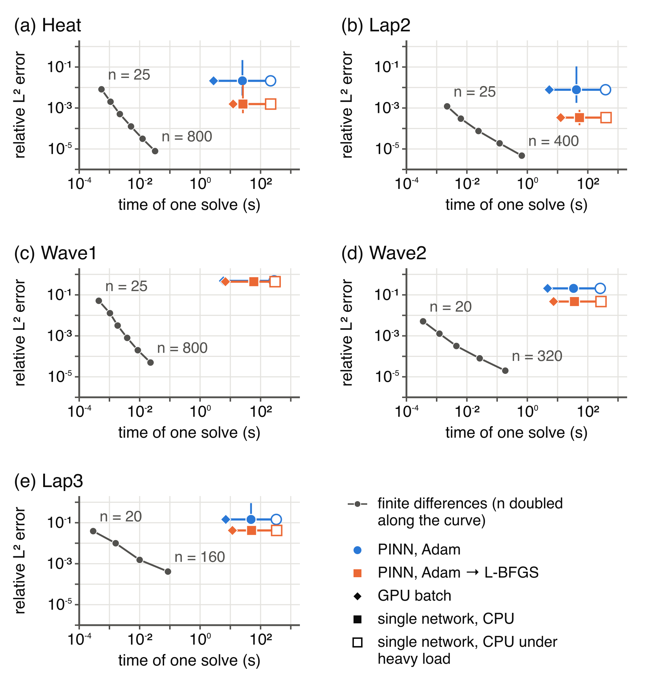

# PINNs and the Deep Ritz method for diffusion, wave and Laplace problems

Article, Supplementary Material, code and data for

> Xiaoxiao Zhouyi, *Physics-informed neural networks and the Deep Ritz method for diffusion, wave and
> Laplace problems: a reproducible benchmark and its failure modes*, 2026.
> [`paper.pdf`](paper.pdf), Supplementary Material [`supplement.pdf`](supplement.pdf)

The article develops a project report written in 2024 during an exchange year at the Hong Kong University of
Science and Technology. [How to cite it](#how-to-cite).

Xiaoxiao Zhouyi · [zhouyixiaoxiao.com](https://zhouyixiaoxiao.com/research/)

## In short

- In all 175 seed-paired comparisons, finishing training with L-BFGS lowered the error. The geometric-mean error fell by a factor of about 14 on the heat problem and 23 on the two-dimensional Laplace problem.
- Second-order finite differences reached equal or better accuracy more than 400 times faster than the PINN in every timing.
- A small overall error can hide a large one. For the heat equation the error at the final time exceeds 100 per cent in all 40 runs examined, although the space-time error is about 0.1 per cent after L-BFGS (1.6 to 2.1 per cent with Adam alone).
- The error bound proved for the unit cube held on all 133 networks evaluated but is loose, at 1.9 to 3.4 times the error at $d=10$ and $d=20$.

[](figures/s5_hard_cost.png)

Accuracy against wall-clock time of one solve (Supplementary Figure S8). Grey: second-order finite differences, the grid parameter $n$ doubling along each curve. Blue circles and orange squares: the Adam and Adam → L-BFGS arms of the PINN (geometric mean over all strategies and seeds; the vertical bar is the range), each drawn at three timings: GPU batch (diamond), single network, CPU (filled marker) and single network, CPU under heavy load (open marker). This is a redrawn copy with larger type; the link opens the figure as printed in the paper.

## What the paper shows

A benchmark study of physics-informed neural networks (PINNs) and of the Deep Ritz method on eight linear
test problems with exact solutions: the one-dimensional heat equation, two wave problems, Laplace problems
in two and three dimensions, and Laplace and Poisson problems on the unit cube in dimension 2 to 20. The
paper

* states each problem with its exact solution and proves that the solution is unique in a stated class;
* trains 175 seeded networks with five collocation strategies and two optimiser arms (Adam only and Adam then L-BFGS) on the five
  low-dimensional problems, and compares them with second-order finite differences;
* compares the PINN and the Deep Ritz method in accuracy and cost as the dimension grows;
* proves, on the unit cube in any dimension $d$, two-sided bounds of exact order $d^{-1/2}$ for the squared norm
  of the harmonic extension from the boundary (the constant is classical; its order in $d$ is new). With it, as
  already with Payne's classical dimension-free bound, the two exact (population) terms of the PINN loss bound
  the $L^2$ error of any $C^2$ network (for example with tanh activations). The paper evaluates that bound under
  a pre-registered protocol and gives the penalty bias of the Deep Ritz method exactly for the Laplace test problem;
* tests two cheap remedies for the accuracy plateau seen at $d=20$ (on PoiD), under a pre-registered protocol
  on four problems (LapD and PoiD, already used in exploratory pilots, and the held-out RidgeD and CosPairD),
  with further problems (AltRidgeD, ExpCosD, SinLinD) added afterwards and reported as non-blind;
* demonstrates two implementation pitfalls on minimal examples: a residual made identically zero by
  differentiating with respect to a slice of the input and replacing the missing derivative by zeros, and a
  boundary-value problem with too few conditions.

The problems are called Heat, Wave1, Wave2, Lap2, Lap3, Lap3s (the digit is the space dimension) and LapD,
PoiD (Laplace and Poisson problems in d dimensions). In file names, keys and comments they also appear as
heat1d/H = Heat, wave1d/W1 = Wave1, wave2d/W2 = Wave2, laplace2d/L2 = Lap2, laplace3d/L3 = Lap3, L3s = Lap3s,
laplace/P1 = LapD and poisson/P2 = PoiD.
The remedy study adds RidgeD, CosPairD, AltRidgeD, ExpCosD and SinLinD (defined in Section 6.8).

## Main results

All errors are relative errors in the $L^2$ norm on held-out points. Details and caveats are in the paper.

### Does an L-BFGS phase help?

**Yes: replacing the second half of the Adam iterations by L-BFGS lowers the error in all 175 pairs.** A separately written verification code agrees in 39 of 40 pairs. In geometric mean the error falls from $2.12\times10^{-2}$ to $1.56\times10^{-3}$ on Heat (a factor of 13.6) and from $7.78\times10^{-3}$ to $3.39\times10^{-4}$ on Lap2 (a factor of 22.9). Against the best logged Adam iterate of each run the gain is still a factor 8 to 13, about one order of magnitude.

### Which collocation strategy is best?

**No single strategy is best throughout.** At the budgets of the benchmark (256 to 1024 points) the ranking changes from problem to problem. On Heat the differences vanish with 1024 points. A fourfold penalty of a cell-centred grid on Heat is caused by the absence of residual points next to the initial line. In a ten-seed control, 16 points placed there remove it and 16 points placed elsewhere do not. Under Adam alone, redrawing the points at every iteration was 6.4 times worse than a fixed random set on Lap2 (10 of 10 seeds; 2.7 times in the verification code, three seeds).

### Is a small space-time error enough?

**No: a small space-time error can hide a large final-time error.** For the decaying heat solution the error on the final time slice exceeds 100 per cent in all 40 runs examined (20 networks, each in both optimiser arms), although the space-time error is about 0.1 per cent after the L-BFGS phase (1.6 to 2.1 per cent after Adam alone).

### Two- and three-dimensional problems

**A few per cent within 3000 iterations, not converged; lower with a longer L-BFGS phase or a compatible datum.** Strategy means are 3.6 to 5.0 per cent (single runs 2.7 to 8.2 per cent) within 3000 iterations, and the runs are not converged. The two-dimensional wave problem reaches 0.6 to 0.9 per cent with a longer L-BFGS phase (three seeds). The three-dimensional problem reaches 0.3 per cent once its discontinuous datum is replaced by a compatible single-mode datum (Lap3s, which also makes the solution a single mode).

### Two-mode wave problem

**Not solved by a small unit-weight PINN.** A unit-weight PINN of three hidden layers of 64 units gives 41 to 51 per cent error in all 50 runs, and 34 to 38 per cent for three seeds trained with 41 000 Adam iterations or with an L-BFGS phase run to its termination (six runs). On a similar problem Rathore et al. (2024) report a few per cent for the run with the lowest loss, with, among other differences, larger networks and more residual points.

### PINN against finite differences

**Finite differences reach equal or better accuracy much faster.** Second-order finite differences reach equal or better accuracy more than 400 times faster than the PINN in every timing. The smallest ratio, 476, is for the per-network share of a GPU run that trains 25 or 50 networks at once; against a single network trained on the CPU the ratio is three to five orders of magnitude.

### PINN against Deep Ritz in d dimensions

**The better method depends on whether the comparison is per iteration or at equal CPU time.** Per iteration the PINN is 1.5 to 4.3 times more accurate for every $d$ up to 10. A Deep Ritz iteration is cheaper, and at equal CPU time Deep Ritz is the more accurate method at $d=10$ in the study and at $d=20$ on the Laplace problem in a re-check with separately written code (three seeds, Deep Ritz 0.92 to 1.04 per cent, PINN 4.6 to 4.8 per cent). Per iteration at $d=20$ the ranking depends on the budget. On the Laplace problem the remaining lead of the PINN after 16 000 iterations is of the size of the penalty bias of Deep Ritz.

### Can the error of a network be bounded by its loss?

**Yes: an explicit bound held on all 133 networks, though it is loose.** On the unit cube, the two exact population terms of the loss (the expected residual and boundary terms), which the training loss estimates, bound the error. With Payne's classical constant this already follows from known theory. The norm of the harmonic extension from $L^2$ of the boundary (surface measure) to $L^2$ of the cube is of exact order $d^{-1/4}$ (Theorem 5). The $L^2$ error of any $C^2$ network (for example with tanh activations) is at most an explicit multiple of the root mean squared residual plus an explicit multiple of the root mean squared boundary misfit (Corollary 7). The second multiple grows like $d^{1/4}$. The constant is classical: it is that of the first biharmonic Steklov eigenvalue. Payne's bound gives a dimension-free value and the torsion-function bound decreases slowly with $d$. The theorem adds the order $d^{-1/2}$ of the squared constant (Section 6.7). The bound held on all 133 networks evaluated, but it is loose, at 1.9 to 3.4 times the error at $d=10$ and $d=20$, up to 25 times at $d=2$. The pre-registered target of at most 3 for $d \ge 5$ failed.

### Does a cheap remedy remove the plateau at d = 20?

**No single remedy is general.** The plateau (a test error no smaller than that of the best affine fit) occurs, among the problems of the pre-registered study, on the Poisson problem PoiD. There a fixed affine part ("presolve") from one linear solve does not remove it. Coordinate-wise Legendre input features (lift3c) do remove it for both methods and in every seed, and they contain the solution of PoiD up to $3.9\times10^{-3}$. For Deep Ritz a featureless reparametrisation of the input (rep3) gains as much, and centring the input alone (the exploratory lift1 arm) also takes both methods off the plateau, with a smaller gain. By the pre-registered rule lift3c is a general remedy on the four pre-registered problems. LapD and PoiD had been used in exploratory pilots of both remedies before the pre-registration, and only RidgeD and CosPairD were held out. On a fifth problem, the ridge AltRidgeD, added afterwards and not a blind test, both the features and the affine part are less accurate than plain, with the affine part also less accurate on RidgeD. How much of the gain of lift3c the features explain differs between problems. On RidgeD centring alone matches it. On ExpCosD, which is on the plateau (0.025 against the affine floor 0.022; a re-check with separately written code, Deep Ritz, three seeds, descriptive), the affine part was 4.5 times more accurate. Neither remedy is general, and neither is new as a method.

### Implementation pitfalls

**Implementation mistakes can produce a zero residual or an underdetermined boundary-value problem.** Differentiating with respect to a slice of the input tensor makes PyTorch raise an error, or return None if allow_unused=True is passed. If that None is replaced by zeros, the PDE term of the loss is exactly zero at every one of 23 550 training iterations while the loss falls from 0.10 to $1.1\times10^{-4}$, and the network ends at relative distance 1.35 from the solution. On the Laplace equation in a cube with data on one face only, five seeds reach comparably small losses with five different functions.

The verification mentioned above was made with separately written code within the same project, on the same
machine. It is a check on the code and the analysis, not a replication by a third party, and it does not cover
the longer runs on Wave2 and Wave1, the problem Lap3s, the slice errors of Heat, the control experiment for the
cell-centred grid, the 16 000-iteration runs at d = 20 and the demonstration of Section 7.1; the demonstration
of Section 7.2 was re-run for three of its five seeds. The analyses of Sections 6.7
and 6.8 were pre-registered (the SHA-256 hash and time of each pre-registration document were recorded in the
repository, `PREREG_FREEZE.json` in the two study folders; no external registry was used) and re-checked in the
same way, in two rounds. How each result was checked is
described in [`notes/VERIFICATION.md`](notes/VERIFICATION.md).

## How to reproduce it

Every figure of the paper and of the Supplementary Material is produced by a script in this repository from
stored per-run results. Every table of results is generated from them by a script or, for the tables
assembled in the text, checked against them by one. Each quantitative statement in the LaTeX sources is
accompanied by a comment `% src: <path>` that names the file in this repository from which the number comes.
[`reproduce.md`](reproduce.md) gives the command for every table and figure and for re-running the training.

```sh
python -m pip install -r requirements.txt
# Checks the headline numbers against the stored results.
python code/check_headline_numbers.py
# Builds main.pdf (copied to paper.pdf) and supplement.pdf.
sh build_pdfs.sh
```

The check takes a few seconds and trains nothing. The results were produced with Python 3.14;
`requirements.txt` lists the package versions used. Trained-network files from the original studies are not included, including those
of the pre-registered evaluation of Section 6.7, whose SHA-256 hashes are in
`research_highdim_bound/results/inventory.json`; the training scripts retrain them.

### Additional d = 20 runs with saved networks

A separate set of 24 PINN runs at $d=20$ (seeds 40–42, problems LapD and SinLinD) is stored with all trained networks in [`research_highdim_remedies/current_machine/`](research_highdim_remedies/current_machine/), together with a script that reloads each network and recomputes its test error. These are descriptive comparisons, kept separate from the earlier studies and not pre-registered. On LapD at 4000 iterations the fixed affine part and the Legendre features (lift3c) improve every seed (median ratio of the plain network's error to theirs 3.56 and 2.86). At 2500 iterations, a budget calibrated to the CPU time of the plain network, lift3c still improves all three seeds (median ratio 1.31) but used 10.5 per cent more CPU time. On SinLinD the affine part is less accurate in all three seeds, while lift3c and the centred input (lift1) improve all three. See Supplementary Table S14 and [`reproduce.md`](reproduce.md).

## Layout

- `paper.pdf`, `supplement.pdf`: the article and its Supplementary Material
- `main.tex`, `supplement.tex`, `macros.tex`, `statements.tex`, `sections/`, `figures/`, `refs.bib`: LaTeX sources (`sections/s*.tex`: article; `sections/S*.tex`: supplement)
- `build_pdfs.sh`: builds both PDFs, which refer to each other
- `code/`: scripts that produce the tables, figures and additional experiments of the paper
- `data/`: their outputs
- `research_benchmark/`: the low-dimensional benchmark: package `pinnbench`, run scripts, raw results
- `research_highdim/`: the study in d dimensions: `scripts/hd_core.py`, run scripts, raw results
- `research_highdim_bound/`: stability constant and computable error bound (Section 6.7): pre-registration, scripts, results, re-checks
- `research_highdim_remedies/`: two remedies at d = 20 (Section 6.8): pre-registration and addendum, scripts, runs, re-checks
- `verify_research_benchmark/`, `verify_research_highdim/`: re-computation of the two studies and separately written verification codes (V-bench, V-dim)
- `notes/VERIFICATION.md`: how the results were checked, the caveats and the working records of the studies
- `reproduce.md`: how to regenerate every table and figure
- `LICENSE`, `LICENSE-CC-BY-4.0.txt`, `requirements.txt`: licences; Python packages

## How to cite

```bibtex
@misc{zhouyi2026pinn,
  author       = {Zhouyi, Xiaoxiao},
  title        = {Physics-informed neural networks and the
                  {Deep} {Ritz} method for diffusion, wave and
                  {Laplace} problems: a reproducible benchmark
                  and its failure modes},
  year         = {2026},
  howpublished = {\url{https://github.com/zhouyi-xiaoxiao/pinn-diffusion-wave-laplace}}
}
```

## Licence and contact

Code (`build_pdfs.sh` and every `*.py` and `*.sh` file): MIT, see [`LICENSE`](LICENSE). Text, figures and data
(every other file): CC BY 4.0, see [`LICENSE-CC-BY-4.0.txt`](LICENSE-CC-BY-4.0.txt).

Xiaoxiao Zhouyi, School of Engineering Mathematics and Technology, University of Bristol, UK.
zhouyixiaoxiao@gmail.com
